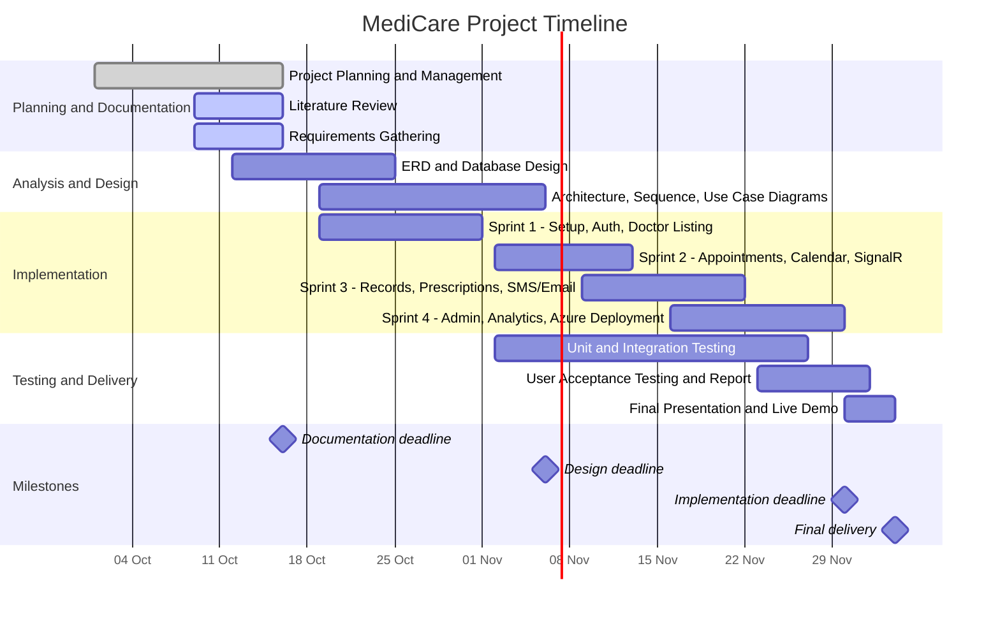

# MediCare: Clinic Management & Appointment System
## 1. Project Planning & Management

**Program:** DEPI | **Document status:** Submission for 16 Oct 2026

---

## 1.1 Project Proposal

### Project Overview
MediCare is a web-based clinic management system designed to improve the way patients, doctors, and clinic administrators manage appointments and medical information.

The system allows patients to search for doctors by specialization, location, and availability, book appointments, and access their medical history and prescriptions. Doctors can manage their schedules, review patient information, create medical records, and issue digital prescriptions. Administrators can manage doctors, patients, specializations, and appointments through an administrative dashboard.

The system will be developed using ASP.NET Core MVC and Entity Framework Core, following an N-Tier architecture to separate the presentation, business logic, and data access layers.

The three layers are implemented as three projects: `MediCare.Web` (presentation), `MediCare.Services` (business logic) and `MediCare.Data` (data access with Repository and Unit of Work patterns).

### Problem Statement
Traditional clinic management may involve manual appointment scheduling, difficulties in managing doctor availability, appointment conflicts, and limited access to patient medical records.

These problems can waste time for patients and doctors and make clinic operations more difficult to manage.

MediCare aims to address these challenges by providing a centralized digital platform for appointment booking, medical record management, notifications, and clinic administration.

### Project Objectives
The main objectives of MediCare are:
- To simplify doctor search and appointment booking.
- To prevent double bookings and scheduling conflicts.
- To help doctors manage their schedules and patient information.
- To provide secure access to medical records and digital prescriptions.
- To send appointment confirmations, updates, and reminders.
- To help administrators manage clinic operations efficiently.
- To provide reports and charts to support decision-making.
- To build a maintainable and scalable system using N-Tier architecture and design patterns.

### Project Scope

**In scope**
- User registration, login, and role-based access for Patients, Doctors, and Admins.
- Doctor listings with search and filtering options.
- Appointment booking, cancellation, rescheduling, and status management.
- Doctor schedules, working hours, and vacation management.
- Real-time notifications and appointment reminders.
- Patient medical records and digital prescriptions.
- Patient profiles and medical history.
- Administrative dashboard for managing users, doctors, and appointments.
- Analytics, reports, and PDF/Excel export.
- Responsive user interface and cloud deployment.

**Out of scope**

Features not specified in the project requirements, such as online payment processing, video consultations, and AI-based diagnosis, are not included in the current scope.

### Technology Stack
- **Backend:** ASP.NET Core MVC
- **Database Access:** Entity Framework Core
- **Authentication:** ASP.NET Identity
- **Real-Time Notifications:** SignalR
- **SMS Notifications:** Twilio
- **Email Notifications:** SendGrid
- **Calendar:** FullCalendar.js
- **Charts:** Chart.js
- **UI Framework:** Bootstrap 5
- **Cloud Deployment:** Microsoft Azure

**Design patterns:** N-Tier Architecture, Repository, Unit of Work, Factory (appointment and notification types), Dependency Injection.

---

## 1.2 Project Plan

### Milestones and Deliverables

| # | Milestone | DEPI Industry Deadline | DEPI Deadline | Key Deliverables |
|---|---|---|---|---|
| 1 | Project Planning & Management | 2 Oct 2026 | 16 Oct 2026 | Proposal, plan, Gantt, roles, risks, KPIs |
| 2 | Literature Review | 9 Oct 2026 | 16 Oct 2026 | Feedback, suggested improvements, grading criteria |
| 3 | Requirements Gathering | 9 Oct 2026 | 16 Oct 2026 | Stakeholders, user stories, use cases, functional and non-functional requirements |
| 4 | System Analysis & Design | 9 Oct 2026 | 6 Nov 2026 | ERD, N-Tier architecture diagram, sequence and use case diagrams |
| 5 | Implementation | 16 Oct 2026 | 30 Nov 2026 | ASP.NET Core solution, EF Core migrations, source code |
| 6 | Testing, Reports & Final Presentation | 16 Oct 2026 | 4 Dec 2026 | Unit tests, user acceptance report, GitHub repo, live demo |

### Gantt Chart

### Resource Allocation

- **Team:** 5 members (see 1.3).
- **Source control:** GitHub repository for code and all documentation.
- **Task tracking:** GitHub Projects board, one card per user story.
- **Development tools:** Visual Studio, .NET SDK, SQL Server.
- **Cloud:** Azure App Service, Azure SQL Database, Azure SignalR Service.
- **External services:** Twilio (SMS) and SendGrid (email), using trial or free tiers.
- **Communication:** Weekly team meeting and a team chat group.

---

## 1.3 Task Assignment & Roles

The team has five members: a project lead who also works on the frontend, a second frontend developer and three backend developers. Testing and documentation are shared: each member tests and documents their own module, and the Project Lead coordinates and maintains the documentation on GitHub.

| Team Member | Role | Primary Responsibilities | Modules and Deliverables |
|---|---|---|---|
| Amna Essam | Project Lead / Frontend Developer | Project coordination, architecture design, repository and Unit of Work patterns, database design, Azure deployment and CI/CD, GitHub documentation; frontend work with Demiana (views, FullCalendar.js, Chart.js, Bootstrap 5) | Solution setup, `MediCare.Data`, DbContext, migrations, deployment, project documents, part of `MediCare.Web` |
| Demiana Hishmat | Frontend Developer / UI | Razor views, ViewModels, FullCalendar.js, Chart.js, Bootstrap 5, dark/light mode, accessibility, client-side validation (shared with Amna) | `MediCare.Web` (Views, controllers, client-side code) |
| Asmaa Rizk | Backend Developer 1 | Authentication and authorization, doctor listing and search, appointment booking, cancel and reschedule, conflict detection, SignalR real-time notifications | `MediCare.Services` (Identity, Doctors search, Appointments, Notifications hub) |
| Mahmoud Ahmed Mohamed | Backend Developer 2 | Doctor schedules, working hours and vacation days, medical records and file uploads, digital prescriptions with print-friendly view, patient profile | `MediCare.Services` (Schedules, Medical Records, Prescriptions, Patient profile) |
| Omnia Shazly | Backend Developer 3 | External notifications (Twilio, SendGrid), automated 24-hour reminders, admin dashboard, analytics and reports, PDF/Excel export | `MediCare.Services` (SMS/Email, Reminder scheduler, Admin, Reports, Export) |

### Shared Responsibilities

- **Testing:** each member writes unit and integration tests for their own module, and the Project Lead reviews coverage.
- **User acceptance testing:** the whole team takes part, and the Project Lead compiles the UAT report.
- **Documentation:** each member documents their own module, and the Project Lead maintains and submits all documents.
- **Code review:** every pull request is reviewed by at least one other member.

---

## 1.4 Risk Assessment & Mitigation Plan

Scale: **High / Medium / Low** for both severity and likelihood.

| ID | Risk | Severity | Likelihood | Impact | Mitigation Strategy | Owner |
|---|---|---|---|---|---|---|
| R1 | Double-booking when two patients book the same slot at the same time | High | Medium | Conflicting appointments, loss of trust | Unique constraint on doctor and time slot at database level, transaction in Unit of Work, concurrency test | Backend 1 |
| R2 | Unauthorized access to medical records and prescriptions | High | Low | Privacy breach | Role-based access via ASP.NET Identity, server-side authorization on every action, HTTPS only, no patient data in URLs or logs | Backend 1 |
| R3 | Database migration errors during layer changes | Medium | Medium | Data loss or broken schema | Structured EF Core migrations, seed data classes, migration review before merge | Lead |
| R4 | Team member unavailable or tasks fall behind schedule | High | Medium | Missed deadlines | Weekly progress check, small user-story-sized tasks, cross-training on core modules | Lead |
| R5 | Third-party service issues (Twilio, SendGrid, Azure limits or cost) | Medium | Medium | Notifications or deployment fail | Use free/trial tiers early, wrap services behind interfaces (Dependency Injection) so they can be mocked, fallback to in-app notifications | Backend 3 |
| R6 | Scope creep from extra features | Medium | High | Core features unfinished | Fixed scope list (1.1), new ideas go to a backlog and are only added after core sprints | Lead |
| R7 | Slow pages with large patient or appointment lists | Low | Medium | Poor user experience | Server-side paging and filtering, indexes on foreign keys | Frontend |
| R8 | Low test coverage on core booking rules | Medium | Medium | Hidden bugs at demo | Unit tests for booking and conflict rules in every sprint, review of test results before sprint close | Lead |
| R9 | Merge conflicts and code integration problems | Medium | Medium | Lost time | Feature branches, pull request reviews, CI build on every push | Lead |
| R10 | Sensitive keys (Twilio, SendGrid, DB) leaked to GitHub | High | Low | Account abuse, security issue | User secrets and environment variables, `.gitignore`, secret scanning on the repository | Lead |

---

## 1.5 Key Performance Indicators (KPIs)

The success of the MediCare Clinic Management and Appointment System will be evaluated using the following Key Performance Indicators:

| # | KPI | Description | Target |
|---|---|---|---|
| 1 | System Response Time | Average time required for the system to respond to user requests | Less than 2 seconds |
| 2 | System Uptime | Percentage of time the system is available and operational | At least 99.5% |
| 3 | User Adoption Rate | Percentage of registered users who actively use the system during a defined period | At least 70% per month |
| 4 | Appointment Booking Success Rate | Percentage of booking attempts that result in successful appointments | At least 95% |
| 5 | Appointment Conflict Rate | Percentage of appointments that conflict with existing bookings | 0% |
| 6 | Appointment Cancellation Rate | Percentage of booked appointments that are cancelled | No more than 10% |
| 7 | Notification Delivery Rate | Percentage of notifications successfully delivered to patients and doctors | At least 95% |
| 8 | Patient Satisfaction Rate | Percentage of positive patient feedback responses | At least 85% |

These KPIs will be monitored using application logs, database records, automated tests, Azure monitoring tools, and notification delivery reports. The proposed targets will help evaluate system performance, reliability, usability, and appointment management efficiency.
